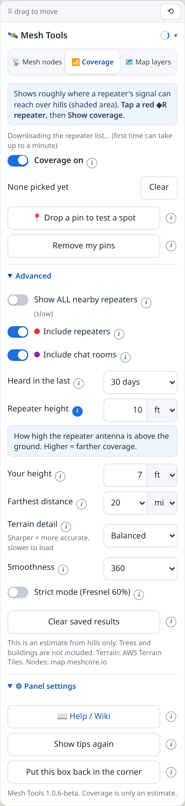

# aprs.fi Mesh Tools

## 📲 Install (easiest way, works on phones)
Firefox on Android is the usual way. Copy this link, open Tampermonkey's **Utilities** page, then use **Import from URL**.

```
https://raw.githubusercontent.com/thescrawler/aprsfi-mesh-tools/main/aprsfi-mesh-tools.user.js
```

1. Long-press the link and choose **Copy link** (or copy it from the box).
2. In Firefox, tap the menu (the three dots), then **Extensions**. Older Firefox says **Add-ons**. Tap **Tampermonkey**. If you already see a Tampermonkey icon, tap that instead.
3. Tap **Dashboard**.
4. At the top of the Dashboard, tap the **Utilities** tab. On a small screen those tabs sit in a row you can slide sideways until **Utilities** shows. Tampermonkey's own help says: if that tab is missing, set **Config mode** to **Beginner** or **Advanced**.
5. Find **Import from URL**, paste the link, and tap **Install**.
6. Tap **Install** again on the next page.

On a computer you can also click the one-click link below. Edge, Kiwi, and iPhone are a little different: [phone steps](docs/Installation.md#installing-on-a-phone).

**New here?** [What is Tampermonkey?](docs/What-is-Tampermonkey.md) explains the free browser add-on, then how to open aprs.fi and use the panel.

A small add-on, run by Tampermonkey, that adds **MeshCore and Meshtastic radios**, a **hill-based coverage estimate**, and **map layer switches** to [aprs.fi](https://aprs.fi), all in one panel that works on a phone.



## Install on a computer

1. Install [Tampermonkey](https://www.tampermonkey.net/). On Chrome or Edge, also turn on **Allow User Scripts** in the extension's details. [How](docs/Installation.md).
2. **[Install aprs.fi Mesh Tools](https://github.com/thescrawler/aprsfi-mesh-tools/raw/main/aprsfi-mesh-tools.user.js)**
3. Open <https://aprs.fi>. The Mesh Tools panel appears in the bottom-right corner.

Edge, Kiwi, and iPhone steps are on the [Installation](docs/Installation.md#installing-on-a-phone) page. Tampermonkey checks for updates from this repository. A Greasy Fork listing is coming later.

## Documentation

📖 **[What is Tampermonkey?](docs/What-is-Tampermonkey.md)** if you have not used it before.

📖 **[User guide](docs/Home.md)**: installation, every setting, how coverage is estimated, troubleshooting and FAQ.

## Beta

This is **beta** software. Coverage is an estimate from the shape of the hills, plus a typical MeshCore radio. Trees and buildings are not included. Please report problems in [Issues](https://github.com/thescrawler/aprsfi-mesh-tools/issues).

Not affiliated with aprs.fi, MeshCore or Meshtastic.

## License

[MIT](LICENSE) © 2026 thescrawler
